<div align="center">


# Radar do Voto 2026

**Painel técnico para comparar as candidaturas das eleições de 4/10/2026 com dados oficiais.**<br/>
20.065 candidaturas de 27 unidades da federação, cruzadas com TSE, Câmara, Senado e Receita, sem chave de API.

[](https://eleicoes-radar.antonio-code.duckdns.org)

[](https://github.com/juninmd/eleicoes-radar/actions/workflows/validate.yml)
[](Dockerfile)
[](tsconfig.json)

<br/>

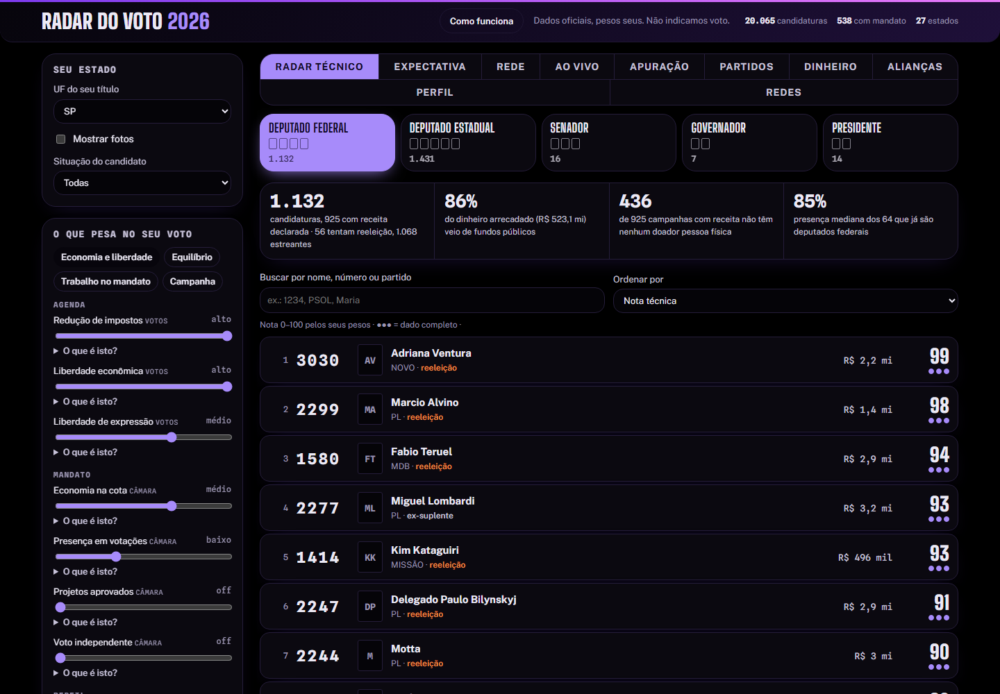

</div>

> **Você escolhe o que pesa; o Radar mostra como cada candidatura se sai nesses critérios.** Abra o site, escolha o
> estado do seu título e mexa nos pesos. Sem cadastro, e o Radar não indica voto: a ordem da lista é a dos pesos escolhidos.

## Por que o Radar

Escopo de propósito estreito: **mostrar o que cada candidatura fez e declarou**. Sem recomendação de voto, sem rótulo de
"fraude" em pessoa ou empresa, sem foto na nota.

⚖️ **Pesos seus.** 11 indicadores (votações de agenda, presença, projetos aprovados, cota parlamentar, renovação, doadores…)
viram posição de 0 a 100; a nota é a média com os pesos que você escolhe. Indicador sem dado conta como mediano; sem nenhum, a nota fica "–".

🏛️ **Só fonte oficial e aberta.** Arquivos do TSE, dados abertos da Câmara e do Senado, Receita (via BrasilAPI e minhareceita),
Wikidata e Wikipédia. Nenhuma chave de API.

🔒 **Sem CPF no que é publicado.** CPF só serve de chave de cruzamento e nunca vai para o JSON público; doador pessoa
física não aparece (há teste de regressão para os dois).

📡 **Apuração direto do TSE.** O navegador lê `resultados.tse.jus.br` a cada 60 s; o servidor do Radar não intermedia nem guarda nada.

## Tour

<table>
<tr>
<td width="50%">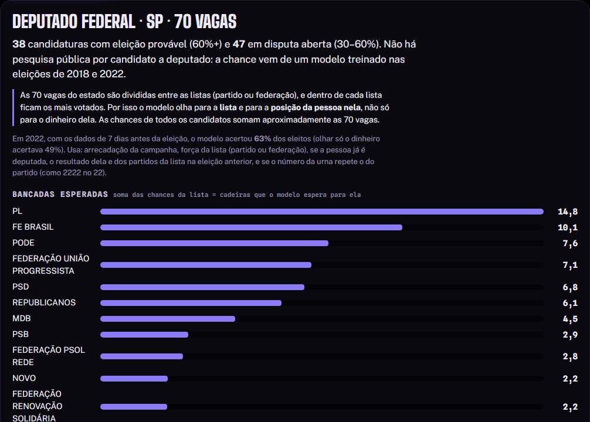<br/><b>Expectativa</b>: chance de vitória pela média das pesquisas (Presidente, Governador, Senador) e por um modelo treinado em 2018 e 2022 (deputados). Não é pesquisa eleitoral.</td>
<td width="50%">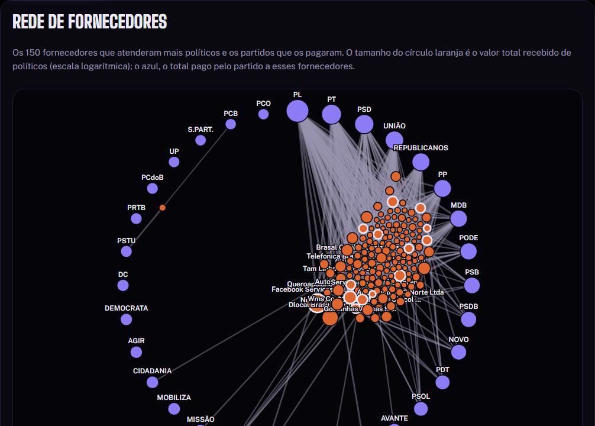<br/><b>Rede</b>: partidos e os 150 fornecedores de campanha (pessoa jurídica) que atenderam mais políticos.</td>
</tr>
<tr>
<td width="50%">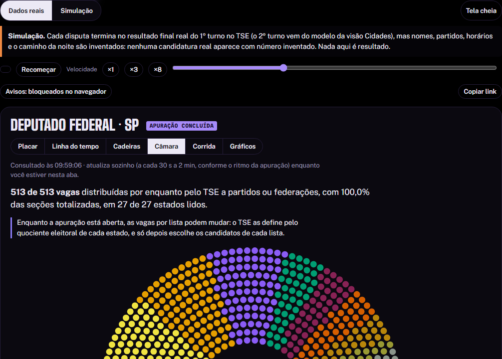<br/><b>Apuração</b>: placar, mapa, projeção, cadeiras e hemiciclo, lidos ao vivo dos arquivos do TSE.</td>
<td width="50%">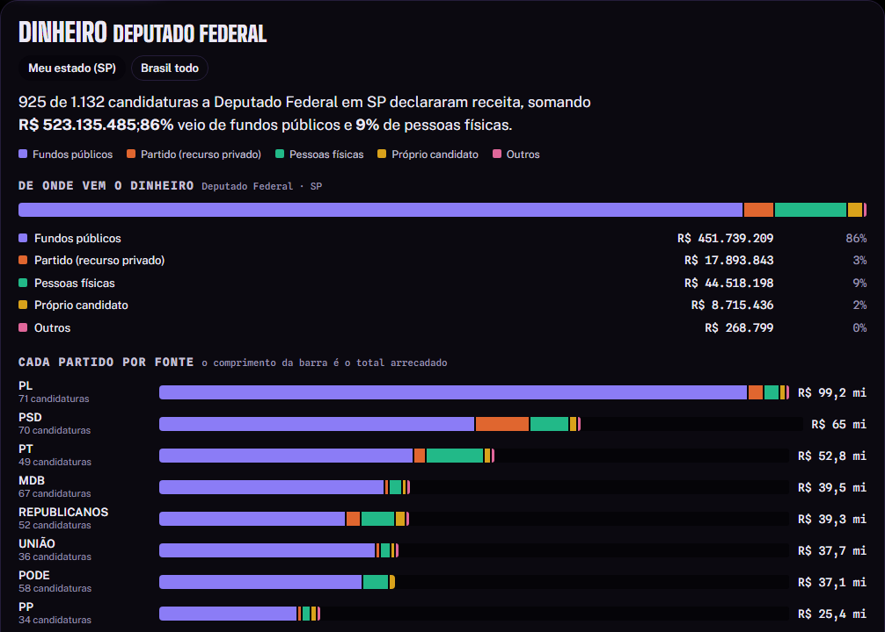<br/><b>Dinheiro</b>: de onde vem o dinheiro da disputa (fundos públicos, partido, pessoas físicas) e cada partido por fonte.</td>
</tr>
<tr>
<td width="50%">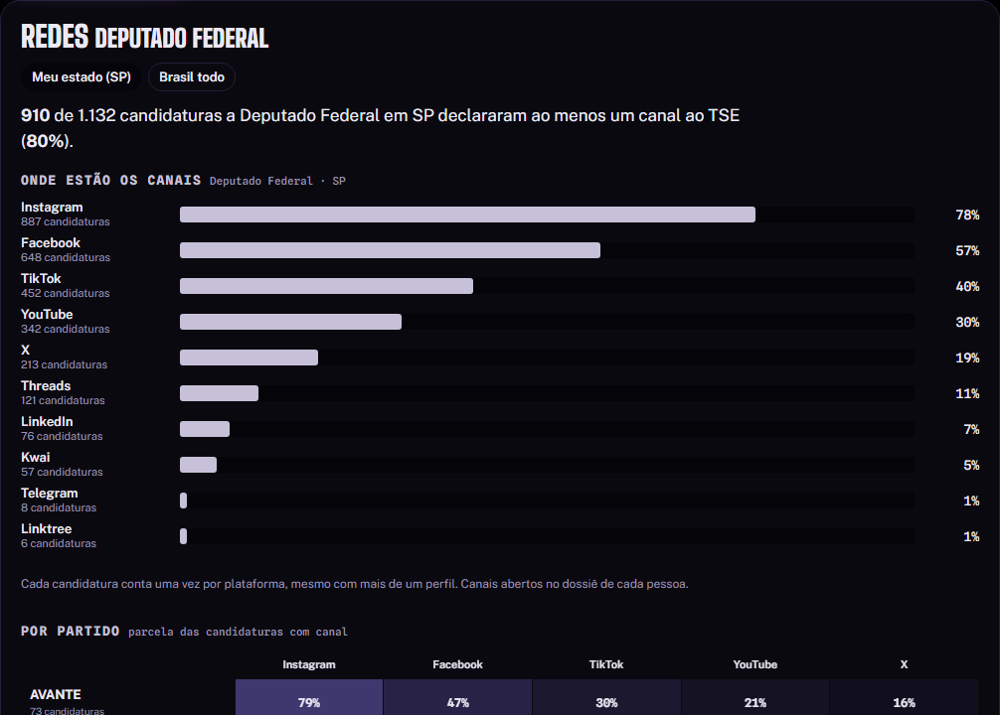<br/><b>Redes</b>: canais declarados ao TSE por plataforma e o gasto com impulsionamento.</td>
<td width="50%">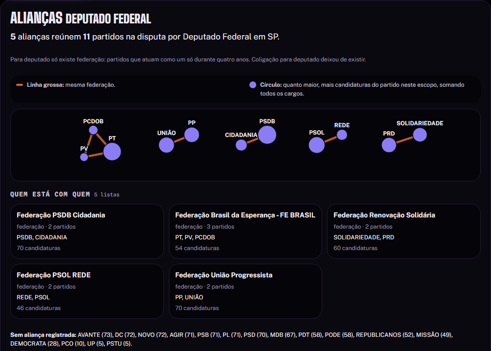<br/><b>Alianças</b>: coligações e federações de cada disputa, do texto oficial do cadastro.</td>
</tr>
</table>

<details>
<summary>Mais telas: Partidos, Perfil, Como funciona</summary>

| Partidos | Perfil |
|---|---|
| 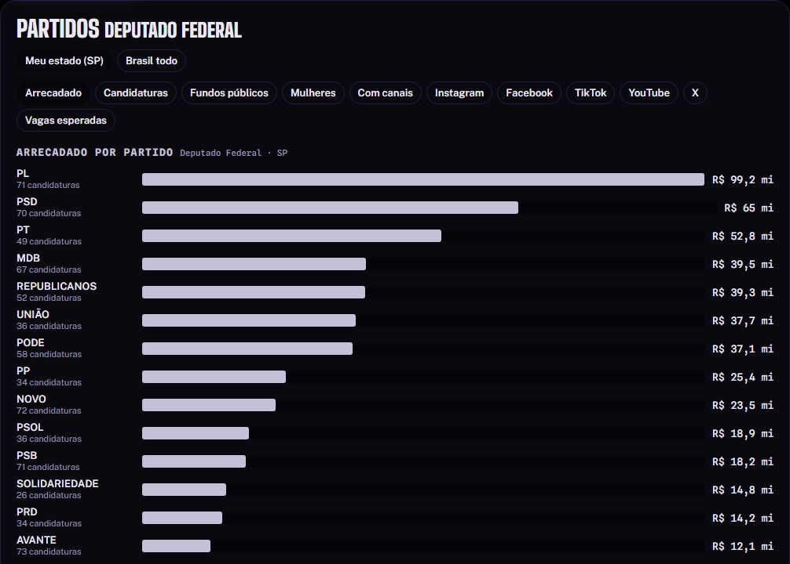 | 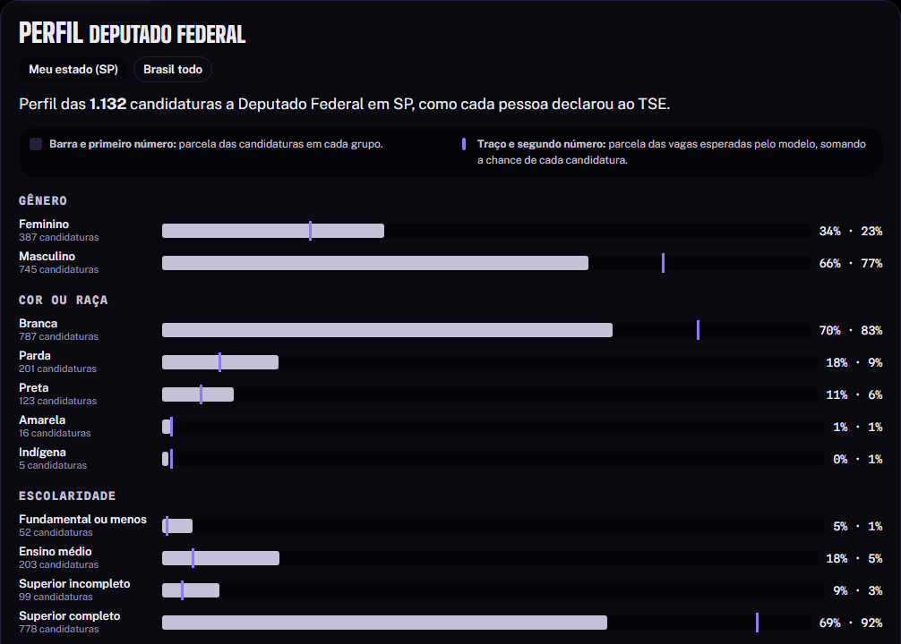 |

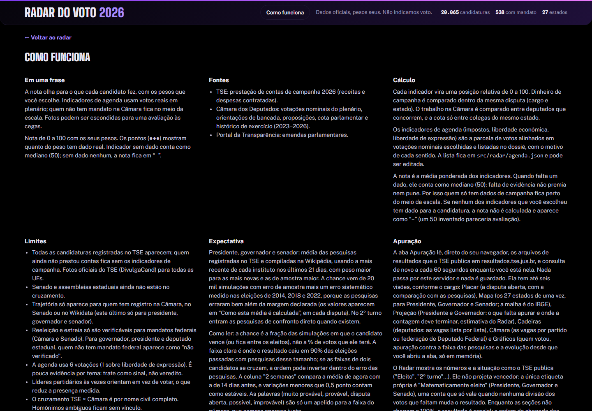

</details>

<sub>Capturas do app real com os dados públicos de 2026 (`bun run screenshots`): estado SP, fotos desligadas e o conjunto de
pesos que abre por padrão (Economia e liberdade). Mudar os pesos muda a ordem. A Apuração lê os arquivos do TSE na hora
da captura, então ela muda a cada execução.</sub>

## Início rápido

O jeito mais curto é o site: **https://eleicoes-radar.antonio-code.duckdns.org**.

Para rodar localmente, o Radar precisa de `web/data/`, que o pipeline gera a partir dos arquivos do TSE (fora do git):

```sh
bun install
bun run radar:fetch       # dados abertos da Câmara
# baixe os zips do TSE para data/tse/ (lista em docs/dados.md)
bun run radar:build       # gera web/data/ (4 a 9 min)
bun run radar:panorama    # agregados das abas Partidos, Dinheiro e Perfil
bun run radar:serve       # http://127.0.0.1:4173
```

> [!NOTE]
> O WAF do TSE devolve 403 a clientes automáticos. `curl -s -A "Mozilla/5.0" -o arquivo.zip <url>` funcionou; se falhar,
> baixe no navegador. Expectativa, trajetória e fornecedores dependem dos passos opcionais do bloco [Desenvolver](#desenvolver).

## Uso

Comparar as candidaturas a Deputado Federal do seu estado:

1. Em **Seu estado**, escolha a UF do título; a cédula de cima troca o cargo.
2. Em **O que pesa no seu voto**, escolha um conjunto (Economia e liberdade, Equilíbrio, Trabalho no mandato, Campanha) ou mexa em cada peso.
3. Abra uma candidatura para ver o dossiê; **Pôr na cola** guarda o número, e **Copiar cola** ou **Imprimir** leva a lista para a cabine em papel.

O servidor responde à verificação de saúde:

```sh
curl -fsS http://127.0.0.1:4173/health
```

```text
ok
```

## Funcionalidades

<table>
<tr>
<td width="36%">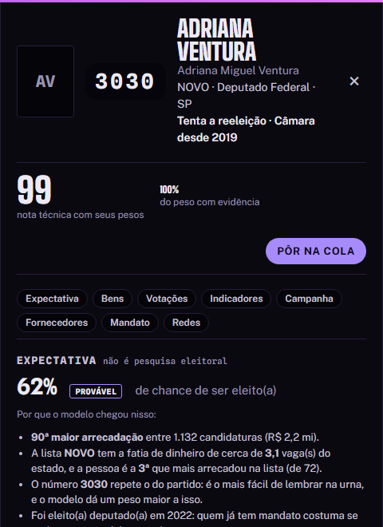</td>
<td>

### 🗂️ Dossiê de cada candidatura

Nota com os seus pesos e quanto dela tem evidência, chance de eleição com o porquê do modelo, ficha do cadastro,
trajetória na Câmara e no Senado, patrimônio declarado e a variação desde 2022, situação do registro, principais
fornecedores com sinais "para conferir", canais oficiais e a proposta de governo registrada no TSE para baixar.
Nada disso entra na nota além dos indicadores.

</td>
</tr>
</table>

- **Ao vivo:** todas as disputas da cédula numa tela, por estado ou Brasil, com quem o TSE já marcou como eleito.
- **Apuração:** "Matematicamente eleito" e "Segundo turno garantido" são provas no pior caso, nunca projeção; o texto do TSE sempre vale mais ([docs/apuracao.md](docs/apuracao.md)). A chave **Simulação** toca uma noite fictícia em todas as visões (resultado real do 1º turno, nomes e caminho inventados), a **Tela cheia** junta a disputa num painel, o **Exterior** mostra o arquivo `zz` e o 1º turno por cidade, e no 2º turno a **Chance ao vivo** dá a chance de cada finalista terminar à frente (estimativa rotulada, nunca "vencedor").
- **Panorama:** Partidos, Dinheiro e Perfil agregados por estado ou Brasil, sem nome nem id, com mínimos de privacidade por célula; Alianças é montada no navegador com as candidaturas do estado aberto.
- **Nota sem dado:** se nenhum indicador escolhido tem dado para a candidatura (ex.: governador com pesos de mandato), a nota
  aparece como "–" e a lista oferece os pesos de Campanha em um clique. A busca ignora acentos.
- **Celular:** o estado vem antes da lista; pesos e cola ficam depois, com o atalho "Ajustar pesos ↓".
- **Desempenho:** CLS medido em 0,008 (desktop) e 0,020 (celular emulado, 390 px), com a altura do que o JS preenche reservada em CSS.

## Atalhos

| Tecla | Ação |
|---|---|
| <kbd>←</kbd> <kbd>→</kbd> <kbd>↑</kbd> <kbd>↓</kbd> <kbd>Home</kbd> <kbd>End</kbd> | troca de aba de visão e de cédula (padrão WAI-ARIA, uma parada de <kbd>Tab</kbd>, painéis ligados por `aria-controls`) |
| <kbd>Enter</kbd> / <kbd>Espaço</kbd> | abre o nó focado no grafo da Rede; escolhe o estado focado no mapa da Apuração |
| <kbd>Esc</kbd> | fecha o dossiê (que recebe o foco ao abrir) e devolve o foco a quem o abriu |

## Como funciona

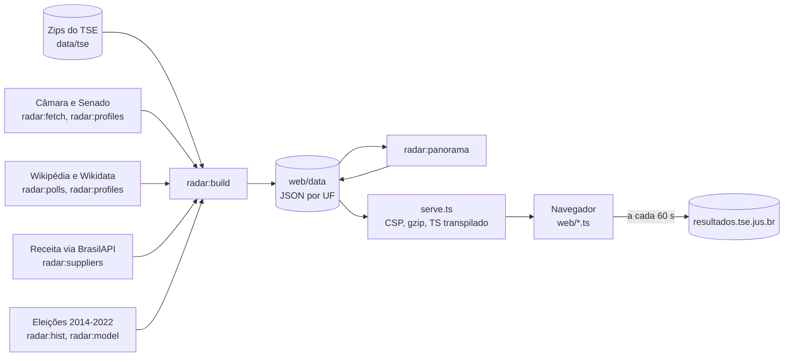

- **Site estático:** o pipeline grava um JSON por UF; a imagem leva só `web/` e `serve.ts`, então o servidor não consulta nada em tempo de execução.
- **TypeScript sem build no navegador:** `serve.ts` transpila `web/*.ts` com `Bun.Transpiler`, com cache por arquivo e mtime; o `.ts` nunca é servido.
- **Apuração sem proxy:** o TSE libera CORS, e a CSP só deixa o navegador falar com a própria origem e com `resultados.tse.jus.br`.
- **Nota previsível:** posição de 0 a 1 por indicador, média ponderada, ausente = 0,5 (`web/score.ts`); método em [docs/metodo.md](docs/metodo.md).
- **CSS gerado:** `web/app.css` sai do Tailwind v4 a partir das folhas escritas à mão e é versionado; `src/radar/css.test.ts` falha se estiver velho.

## Configuração

| Variável | Para quê | Padrão | Exemplo |
|---|---|---|---|
| `PORT` | porta do `serve.ts` | `4173` (`3000` na imagem) | `8080` |
| `HOST` | interface de rede do `serve.ts` | `127.0.0.1` (`0.0.0.0` na imagem) | `0.0.0.0` |
| `WEB_ROOT` | pasta servida | `web` | `/srv/radar/web` |
| `TSE_ZIP` | zip de contas do TSE para o `radar:build` | `data/tse/prestacao_de_contas_eleitorais_candidatos_2026.zip` (ou o mesmo nome em `data/`) | `outro/contas-2026.zip` |
| `AGENDA` | votações que alimentam os indicadores de agenda | `src/radar/agenda.json` | `outra-agenda.json` |
| `BASE_URL` | servidor que o `bun run screenshots` fotografa | `http://127.0.0.1:4173` | `http://127.0.0.1:4189` |
| `OUT_DIR` | pasta das capturas | `.github/assets/screenshots` | `.playwright-mcp/teste` |

## Desenvolver

Requer Bun 1.3 (a imagem usa `oven/bun:1.3.13-slim`). Node 24 só para `bun run screenshots`: o Playwright não abre o Chromium sob o Bun no Windows.

```sh
bun install                    # dependências
bun run radar:fetch            # arquivos abertos da Câmara (idempotente; --force atualiza)
bun run radar:polls            # pesquisas da Wikipédia -> data/pesquisas.json (versionado; cache diário; --force atualiza)
bun run radar:hist 2014        # (uma vez; também 2018 e 2022, ~3 min cada) resultados e contas antigas -> data/hist/
bun run radar:model            # modelo de deputados treinado em 2018 e 2022 -> data/modelo-deputados.json
bun run radar:mc-backtest      # (análise) logística vs Monte Carlo, deixando uma eleição de fora
bun run radar:profiles         # trajetória e fotos de reserva (Câmara, Senado, Wikidata)
bun run radar:suppliers        # CNPJ dos fornecedores na Receita (sem chave; retomável)
bun run radar:bu 2026 SP       # (opcional) Boletim de Urna oficial do 1º turno -> web/data/bu/
bun run radar:build            # gera web/data/ (uf/<UF>.json, fotos/, expectativa.json, meta.json)
bun run radar:panorama         # web/data/panorama.json (sempre depois do build)
bun run radar:geo              # (uma vez) malha dos estados do IBGE -> web/mapa-uf.json (versionado)
bun run radar:geo-mundo        # (uma vez) contornos do mapa-múndi (Natural Earth) -> web/mapa-mundo.json (versionado)
bun run radar:mun-hist <ano>   # Presidente e Governador por município (2002-2026), um ano por vez -> data/hist/mun-<ano>.json
bun run radar:mun-backtest     # ajuste e erros do 2º turno por município (2002-2022) -> data/municipal-modelo.json
bun run radar:municipal        # 1º turno de 2026 por município das disputas com 2º turno -> web/data/municipal/ (vista "Cidades")
bun run radar:serve            # http://127.0.0.1:4173 (saúde: /health)
bun run css                    # regenera web/app.css depois de editar uma folha .css
bun test src/radar web         # testes
bun run typecheck              # tsc estrito sobre src/radar e web
bunx playwright install chromium --only-shell  # (uma vez) navegador do script de capturas
bun run screenshots            # refaz .github/assets/screenshots a partir do app rodando
```

## Contribuir

Commits seguem Conventional Commits (`feat(apuracao): …`, `fix(serve): …`). As regras do projeto (invariantes de
neutralidade e privacidade, armadilhas de cada fonte, checklist de nova eleição) ficam no [AGENTS.md](AGENTS.md).
Antes de abrir um PR: `bun test src/radar web`, `bun run typecheck` e, se mexeu em CSS, `bun run css`.

## Documentação

| Documento | O que tem |
|---|---|
| 📊 [Método](docs/metodo.md) | indicadores e nota, Expectativa (pesquisas e modelo de deputados), Panorama e regras de privacidade dos agregados |
| 📡 [Apuração](docs/apuracao.md) | arquivos do TSE, visões, provas "matematicamente eleito" e "segundo turno garantido", projeção |
| 🗂️ [Dados](docs/dados.md) | download manual do TSE e fontes de enriquecimento do dossiê |
| 🚀 [Deploy](docs/deploy.md) | imagem, publicação, rollback e cabeçalhos de segurança |
| 🧭 [AGENTS.md](AGENTS.md) | runbook para refazer em 2028/2030: chaves de cruzamento, armadilhas, backtests e calibração |

## Segurança

| Camada | Proteção |
|---|---|
| Servidor | CSP `default-src 'none'`, script só da própria origem, `connect-src` só a origem e `resultados.tse.jus.br`, `X-Frame-Options: DENY`, `Referrer-Policy: no-referrer` em toda resposta |
| Dados publicados | sem CPF nem doador pessoa física no JSON; `maskCpf` limpa CPF embutido em nome de fornecedor (teste de regressão) |
| Links externos | redes sociais só em https de hosts conhecidos; WhatsApp e site arbitrário descartados |
| Apuração | nenhuma URL montada a partir de entrada do usuário: `tseUrl` aceita só cargo conhecido e UF de 2 letras |
| Imagem | `.dockerignore` em lista de permissão (só `web/` e `serve.ts`), processo como usuário `bun`, fontes servidas localmente |

## Limitações conhecidas

- **Cobertura:** todas as candidaturas do cadastro do TSE entram na lista; quem ainda não prestou contas fica sem os indicadores de campanha.
- **Mandatos fora da Câmara:** mandatos no Senado e nas assembleias estaduais ainda não entram nos indicadores; reeleição e estreia só são verificáveis para mandato federal.
- **Presença:** usa `/deputados/{id}/historico` para descontar licenças, mas líderes que só orientam a bancada têm presença medida menor.
- **Cruzamento TSE × Câmara:** por CPF do cadastro do TSE × cota parlamentar, com nome civil + UF como reserva; homônimo ambíguo fica sem vínculo.
- **Expectativa:** não é pesquisa eleitoral. A faixa da Projeção da Apuração usa ruídos que não foram calibrados contra eleições passadas, e a Chance ao vivo do 2º turno nunca foi testada durante uma apuração (só o resultado final do modelo).
- **Contas parciais:** a prestação de contas é o retrato do TSE de uma data, mostrada na interface.
- **Dados fora do CI:** os zips do TSE não estão no git e o WAF bloqueia downloads automáticos, então `web/data` só é gerado numa máquina que rodou o pipeline.
- **Só tema escuro:** a interface não oferece modo claro.
- **Código antigo:** `src/*.ts` (fora de `src/radar`) e `dashboard/` são a versão anterior (ranking de "fraude" de deputados de SP), mantidos sem alteração e fora do Radar.

## Inspirações

| Projeto | O que aproveitamos (avaliado em 2026-10-04) |
|---|---|
| [seuimposto.com](https://seuimposto.com) | na Apuração: manchete de 2º turno com a conta, barra do duelo com a linha dos 50%, diferença em votos por extenso e feed por marcos |

## Licença

Ainda sem arquivo de licença; sem ele, valem todos os direitos reservados ao autor. As fontes tipográficas em `web/fonts/`
seguem a licença OFL (textos ao lado de cada uma), e a malha dos estados é do IBGE.

<div align="center"><sub>Feito com Bun e TypeScript a partir de dados públicos do TSE, da Câmara, do Senado e da Receita.</sub></div>

